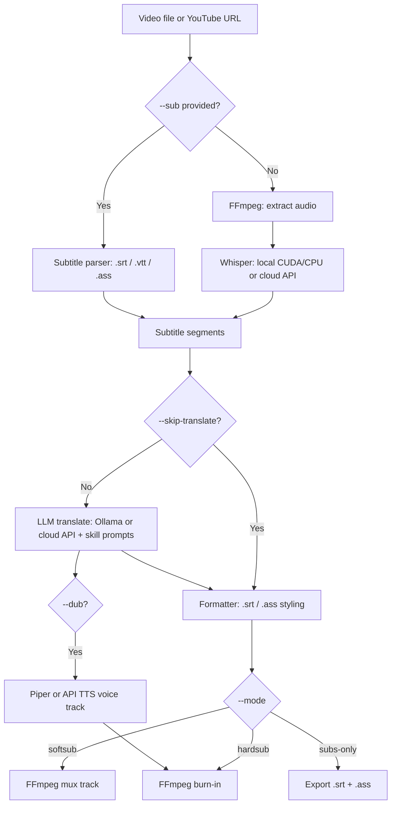

# Echo

<p align="center">
  
</p>

<p align="center">
  <strong>Transcribe, translate, dub, and burn subtitles into videos — local-first, no cloud required.</strong>
</p>

<p align="center">
  <a href="https://github.com/enolalab/echo/releases"></a>
  <a href="https://www.rust-lang.org/"></a>
  <a href="LICENSE"></a>
</p>

**Echo** is a desktop app and CLI written in **Rust** that automates the entire subtitle workflow: extracting audio from a video, transcribing speech with Whisper, translating subtitles with an LLM, optionally dubbing a synthesized voice track, and muxing or burning subtitles into the output file.

Everything runs **fully offline** if you want it to — whisper.cpp for transcription, Ollama for translation, Piper for voice dubbing. Cloud APIs (OpenAI, Groq, DeepSeek, Anthropic, Gemini-compatible endpoints) are supported as drop-in alternatives.

---

## Features

### 🖥️ Echo Studio (Desktop GUI)
- All-in-one workspace powered by **Tauri v2 + React + Tailwind CSS**.
- Integrated video player with real-time subtitle preview and an editable subtitle table.
- Bidirectional sync: click a segment to seek; playback highlights and auto-scrolls the active row.
- One-click Whisper model management, automatic CUDA GPU detection, and local Ollama model probing.
- **YouTube import**: paste a URL, Echo downloads the video with a self-managed `yt-dlp` binary.
- Styled preview presets: *YouTube Yellow*, *Classic White*, *Netflix Modern*, *Bilingual Highlight*.

### 🎙️ Transcription
- **Local**: `whisper-rs` (whisper.cpp) with multi-threaded CPU and NVIDIA CUDA acceleration; graceful GPU → CPU fallback when VRAM runs out.
- **Cloud**: OpenAI Whisper API or Groq, with automatic MP3 compression to fit 25 MB API limits.
- Whisper GGML models (`tiny` → `large-v3`) are downloaded on demand with progress bars.

### 🌐 Translation
- **Local LLM** via Ollama (`qwen2.5:7b` by default, any model works).
- **Cloud LLM** via any OpenAI- or Anthropic-compatible endpoint (DeepSeek, ChatGPT, Gemini…).
- **Provider profiles**: save named provider configurations and switch with `--profile` or in the GUI.
- **Translation skills**: domain-tuned prompt presets (AI/ML, programming, math, physics, chemistry, biology) selectable with `--skill` or in the GUI — or bring your own.
- Batch translation with concurrent requests and retries to preserve dialogue context and pronouns.

### 🔊 Voice Dubbing
- Generate a synthesized voice-over track from translated subtitles (`--dub` or the GUI export toggle).
- **Piper** local TTS with a downloadable voice catalog (including Vietnamese voices like `vi_VN-vais1000-medium`) — or any OpenAI-compatible `/audio/speech` endpoint.
- Original audio is ducked underneath (configurable with `--dub-orig-volume`).

### 📦 Output Modes
- **Hardsub** — burn styled subtitles into the picture (with `fast` / `balanced` / `quality` render presets, `--crf` quality control, and GPU-assisted decode). All non-video streams, metadata, and chapters pass through unchanged.
- **Softsub** — embed subtitle tracks (`mov_text` for MP4, `srt` for MKV) without re-encoding video.
- **Subs-only** — export `.srt` and `.ass` files without touching the video.
- **Bilingual** — show original and translated lines simultaneously with distinct typography.
- Existing `.srt` / `.vtt` / `.ass` files can be fed straight in with `--sub`, skipping STT entirely.

### 🛡️ Zero-Config & Safe
- Automatically provisions static FFmpeg, Whisper models, Piper, and yt-dlp into user data directories.
- API keys are stored in the OS keychain (not in plain-text config).
- Strict path protection: input files are never overwritten.

---

## Installation

### Download the app

Pre-built installers for **Windows, macOS (Intel & Apple Silicon), and Linux** are published on the [Releases page](https://github.com/enolalab/echo/releases).

### Build from source

**Prerequisites:**

- Rust 1.80+ (2021 edition)
- C/C++ build tools: `cmake`, `clang`, `libclang-dev`, `pkg-config`
- Node.js 20+ (for the GUI)
- Optional: NVIDIA CUDA Toolkit (`nvcc`) for GPU acceleration
- Optional: [Ollama](https://ollama.com/) for local translation (`ollama pull qwen2.5:7b`)
- FFmpeg on `PATH` — auto-downloaded on Linux x86_64; on macOS use `brew install ffmpeg`, on Windows `winget install ffmpeg`

```bash
# Debian / Ubuntu system deps (CLI + GUI)
sudo apt install -y build-essential cmake clang libclang-dev pkg-config \
  libwebkit2gtk-4.1-dev libappindicator3-dev librsvg2-dev patchelf \
  libasound2-dev libssl-dev libdbus-1-dev

git clone https://github.com/enolalab/echo.git
cd echo

# CLI only
cargo build --release               # binary at target/release/auto-subtitle
cargo build --release --features cuda   # with CUDA acceleration

# Desktop app
npm install && npm --prefix ui install
npm run dev                         # dev mode (hot reload)
npm run build:app                   # production bundle / installer
```

Or use the Makefile shortcuts: `make local`, `make build`, `make install`, `make test`. The Makefile auto-enables the `cuda` feature when `nvcc` is detected.

---

## Usage

### GUI

1. Launch Echo Studio (`npm run dev` or install a release build).
2. Drop a video file — or paste a YouTube URL.
3. Pick a Whisper model and a translation provider/skill in Settings.
4. Edit subtitles inline, choose a style preset, then export (optionally with dubbing).

### CLI

```bash
# Fully automatic: local Whisper + Ollama translation + hardsub
auto-subtitle -i video.mp4

# Bilingual subtitles (original + Vietnamese)
auto-subtitle -i video.mp4 --bilingual

# Burn an existing subtitle file, no translation
auto-subtitle -i video.mp4 --sub subs.srt --skip-translate

# Softsub (no video re-encode) / subtitles only
auto-subtitle -i video.mp4 --mode softsub
auto-subtitle -i video.mp4 --mode subs-only --whisper-model base

# Cloud pipeline (DeepSeek example)
auto-subtitle -i video.mp4 \
  --stt-engine api \
  --api-key "sk-..." \
  --api-base-url "https://api.deepseek.com/v1" \
  --api-model "deepseek-chat"

# Translated + dubbed with a local Piper voice
auto-subtitle -i video.mp4 --dub --tts-voice vi_VN-vais1000-medium

# Use a saved provider profile and a domain translation skill
auto-subtitle -i video.mp4 --profile deepseek --skill programming
auto-subtitle --list-profiles
auto-subtitle --list-skills
```

### CLI reference

| Flag | Default | Description |
| :--- | :--- | :--- |
| `-i, --input <PATH>` | *(required)* | Input video file |
| `-o, --output <PATH>` | `<stem>_subtitled.mp4` | Output path or directory |
| `--subtitle, --sub <PATH>` | — | Existing `.srt`/`.vtt`/`.ass`; skips STT |
| `--skip-translate` | `false` | Skip the translation step |
| `-s, --source-lang <LANG>` | `auto` | Source language code |
| `-t, --target-lang <LANG>` | `vi` | Target translation language |
| `-m, --mode <MODE>` | `hardsub` | `hardsub`, `softsub`, `subs-only` |
| `-b, --bilingual` | `false` | Render bilingual subtitles |
| `--stt-engine <ENG>` | `local` | `local` (whisper.cpp) or `api` |
| `--whisper-model <M>` | `small` | `tiny`, `base`, `small`, `medium`, `large-v3` |
| `--stt-api-model <M>` | `whisper-1` | Model name for cloud STT |
| `--translate-engine <E>` | `ollama` | `ollama` or `openai-compat` |
| `--profile <NAME>` | — | Provider profile from settings.json |
| `--list-profiles` | — | Print configured profiles and exit |
| `--skill <NAME>` | — | Translation skill/preset, or `none` |
| `--list-skills` | — | Print available skills and exit |
| `--ollama-model <M>` | `qwen2.5:7b` | Ollama model name |
| `--ollama-url <URL>` | `http://localhost:11434` | Ollama base URL |
| `--api-key <KEY>` | `OPENAI_API_KEY` env | API key for cloud services |
| `--api-base-url <URL>` | `https://api.openai.com/v1` | OpenAI-compatible endpoint |
| `--api-model <M>` | `gpt-4o-mini` | Chat model for translation |
| `--translate-concurrency <N>` | `4` | Max concurrent translation requests |
| `--no-gpu` | `false` | Force CPU even when CUDA is available |
| `--render-speed <P>` | `balanced` | `fast`, `balanced`, `quality` (hardsub) |
| `--crf <N>` | `20` | Video quality target 0–51; lower = better/bigger (hardsub) |
| `--dub` | `false` | Add a synthesized voice track |
| `--tts-engine <E>` | `local` | `local` (Piper) or `api` |
| `--tts-voice <V>` | — | Piper voice id, API voice, or `.onnx` path |
| `--tts-model <M>` | `tts-1` | Model for API TTS |
| `--dub-orig-volume <F>` | `0.15` | Original audio volume under the dub (0–1) |
| `--keep-temp` | `false` | Preserve temporary work files |

---

## How it works



---

## Configuration

User configuration lives in `settings.json` under the platform config dir (`~/.config/auto-subtitle/` on Linux). The GUI edits it for you; CLI users can manage **provider profiles** (named OpenAI/Anthropic/DeepSeek/Ollama configs) and **default skills** there too. Secrets never land in this file — they go to the OS keychain.

Downloaded assets (FFmpeg, Whisper GGML models, Piper voices, yt-dlp) are cached in `~/.cache/auto-subtitle/` (Linux) or the platform equivalent.

---

## Development

```bash
make install      # JS deps (root + ui workspaces)
make local        # desktop app in dev mode (Vite + Rust hot reload)
make dev-web      # browser-only UI dev with mocked IPC
make build        # production frontend + desktop bundle
make test         # cargo test --workspace + npm --prefix ui test

cargo fmt --check
cargo clippy --all-targets -- -D warnings
```

Releases are produced by the `Tag & Release` GitHub Actions workflow: it tags `v<version>-build.<commit-count>` and builds Windows, Linux, and macOS (x64 + ARM) bundles.

---

## Contributing

Issues and pull requests are welcome. Please run `cargo fmt` and `cargo clippy` before submitting.

## License

[MIT](LICENSE)

## Acknowledgements

Built on [whisper.cpp](https://github.com/ggerganov/whisper.cpp), [FFmpeg](https://ffmpeg.org/), [Piper](https://github.com/rhasspy/piper), [yt-dlp](https://github.com/yt-dlp/yt-dlp), [Ollama](https://ollama.com/), and [Tauri](https://tauri.app/).
