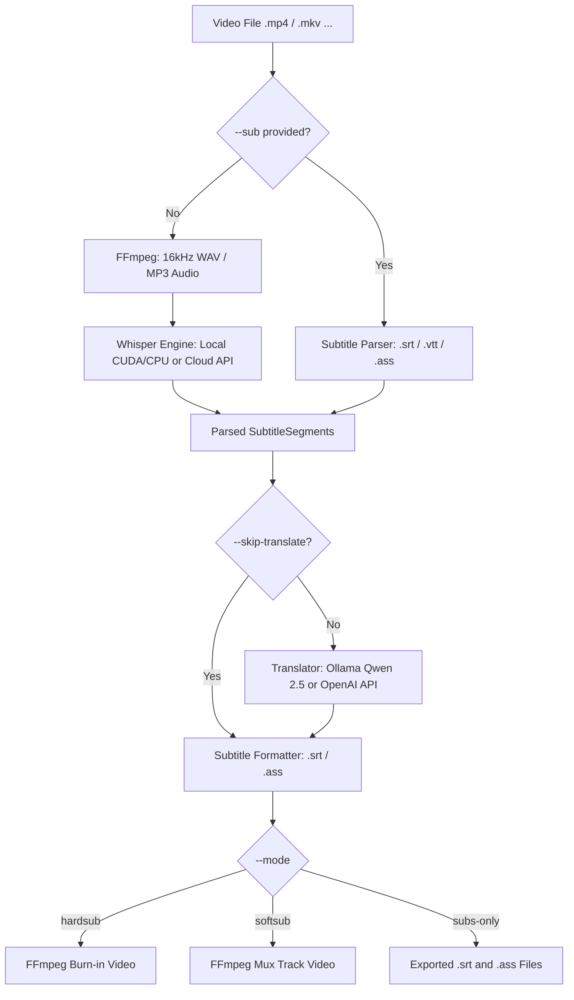

# Echo 🎬🔊

**Echo** is a fast, robust, and modular CLI application written in **Rust** that automates the end-to-end workflow of transcribing video audio, translating subtitles via local LLM or Cloud API, and embedding (hardsub or softsub) subtitles into video files.

[](https://www.rust-lang.org/)
[](LICENSE)

---

## ✨ Features

- 🎙️ **Speech-to-Text (STT):**
  - **Local Offline:** Powered by `whisper-rs` (C++ `whisper.cpp` engine) with multi-threaded CPU and NVIDIA GPU CUDA acceleration.
  - **Graceful Fallback:** Automatically falls back from GPU to CPU if VRAM is exhausted.
  - **Cloud API Fallback:** Compatible with OpenAI Whisper API and Groq with automatic MP3 compression (stays within 25MB limits).
- 🌐 **Context-Aware Translation:**
  - **Local LLM:** Integrated with **Ollama** (`qwen2.5:7b` by default, or any model of your choice).
  - **Cloud API:** Compatible with any OpenAI-compatible endpoints (DeepSeek, ChatGPT, Gemini, etc.).
  - **Batch Processing:** Translates subtitles in batches of 20 with isolated local indexing (`1..=20`) and automatic retries (up to 3 attempts) to preserve dialogue context and pronouns.
- ⏩ **Existing Subtitle Input (`--sub` / `--subtitle`):**
  - Supports `.srt`, `.vtt`, and `.ass` files.
  - Bypasses audio extraction and STT completely.
  - Supports `--skip-translate` for burning/muxing pre-translated subtitles immediately.
- 🎨 **Flexible Subtitle Formatting:**
  - Generates standard `.srt` and styled `.ass` subtitles.
  - **Bilingual Subtitles (`--bilingual`):** Displays original language and translated language simultaneously with custom typography.
- 📦 **Output Modes:**
  - **Hardsub:** Burns high-contrast styled subtitles directly into the video picture.
  - **Softsub:** Embeds subtitle tracks into the container (`mov_text` for MP4, `srt` for MKV) without re-encoding video.
  - **Subs-only:** Generates `.srt` and `.ass` files without touching the video.
- 🛡️ **Zero-Config UX & Data Safety:**
  - Automatically downloads static FFmpeg (with `libass` support) and Whisper GGML models to user cache (`~/.cache/auto-subtitle/`) with terminal progress bars.
  - Strict path protection: Guarantees user input files are never overwritten.

---

## 🏗️ Architecture & Data Flow



---

## 📋 Prerequisites

- **Rust:** Rust 1.80+ (2021 Edition) (`cargo`, `rustc`)
- **C/C++ Build Tools:** `cmake`, `clang`, `libclang-dev`, `pkg-config` (for compiling `whisper.cpp`)
  ```bash
  # Debian / Ubuntu
  sudo apt install -y build-essential cmake clang libclang-dev pkg-config
  ```
- **Optional GPU Support (NVIDIA):** CUDA Toolkit (`nvcc`) for GPU acceleration.
- **Optional Local LLM (Ollama):**
  ```bash
  curl -fsSL https://ollama.com/install.sh | sh
  ollama pull qwen2.5:7b
  ```

---

## 🚀 Installation & Build

```bash
# Clone repository
git clone https://github.com/enolalab/echo.git
cd echo

# Build standard release (CPU)
cargo build --release

# Build with NVIDIA CUDA GPU acceleration
cargo build --release --features cuda
```

The compiled binary will be located at `target/release/auto-subtitle`.

---

## 🖥️ Echo Studio (Desktop GUI)

Echo includes a modern, high-performance desktop studio app powered by **Tauri v2** and **React + Tailwind CSS**:

- **Studio All-in-One Layout:** Integrated video player with real-time subtitle preview and editable subtitle table.
- **Bidirectional Video Sync:** Click any subtitle segment to seek video; playback automatically highlights and auto-scrolls the active row.
- **Auto Model & GPU Detection:** Auto-detects NVIDIA CUDA GPU acceleration, probes local Ollama models (`localhost:11434`), and manages Whisper model downloads with 1-click in the UI.
- **Visual Styling Presets:** Choose from *YouTube Yellow*, *Classic White*, *Netflix Modern*, and *Bilingual Highlight*.

### Launching the Desktop UI

```bash
# 1. Install frontend dependencies
npm --prefix ui install

# 2. Run in desktop development mode
npm --prefix ui run tauri dev

# 3. Build standalone installer / binary package
npm --prefix ui run tauri build
```

---

## 💻 CLI Options

| Flag | Short | Default | Description |
| :--- | :--- | :--- | :--- |
| `--input <PATH>` | `-i` | *(Required)* | Input video file path |
| `--output <PATH>` | `-o` | `<stem>_subtitled.mp4` | Output video file path or directory |
| `--subtitle <PATH>` | `--sub` | None | Existing subtitle file (`.srt`, `.vtt`, `.ass`), skips STT |
| `--skip-translate` | | `false` | Skip translation step |
| `--source-lang <LANG>` | `-s` | `auto` | Source language code |
| `--target-lang <LANG>` | `-t` | `vi` | Target translation language |
| `--mode <MODE>` | `-m` | `hardsub` | `hardsub`, `softsub`, or `subs-only` |
| `--bilingual` | `-b` | `false` | Render bilingual subtitles |
| `--stt-engine <ENG>` | | `local` | `local` (whisper.cpp) or `api` (OpenAI/Groq) |
| `--whisper-model <M>` | | `small` | GGML model: `tiny`, `base`, `small`, `medium`, `large-v3` |
| `--translate-engine <E>` | | `ollama` | `ollama` (local) or `openai-compat` |
| `--ollama-model <M>` | | `qwen2.5:7b` | Model name deployed in Ollama |
| `--ollama-url <URL>` | | `http://localhost:11434` | Ollama service base URL |
| `--api-key <KEY>` | | None | API key for cloud STT or translation (`OPENAI_API_KEY`) |
| `--api-base-url <URL>` | | `https://api.openai.com/v1` | Base URL for OpenAI-compatible endpoint |
| `--api-model <M>` | | `gpt-4o-mini` | Chat model for OpenAI-compatible endpoint |
| `--keep-temp` | | `false` | Preserve temporary audio and subtitle work files |

---

## 📖 Usage Examples

### 1. Fully Automatic (Local Whisper + Ollama Translation + Hardsub)
```bash
auto-subtitle -i video.mp4
```

### 2. Bilingual Subtitles (Original Language + Vietnamese)
```bash
auto-subtitle -i video.mp4 --bilingual
```

### 3. Burn an Existing Subtitle without Translation
```bash
auto-subtitle -i video.mp4 --sub my_subtitles.srt --skip-translate
```

### 4. Fast Softsub (No Video Re-encoding)
```bash
auto-subtitle -i video.mp4 --mode softsub
```

### 5. Export Subtitles Only (.srt & .ass)
```bash
auto-subtitle -i video.mp4 --mode subs-only --whisper-model base
```

### 6. Cloud Mode (OpenAI / DeepSeek / Groq)
```bash
auto-subtitle -i video.mp4 \
  --stt-engine api \
  --translate-engine openai-compat \
  --api-key "sk-..." \
  --api-base-url "https://api.deepseek.com/v1" \
  --api-model "deepseek-chat"
```

---

## 🧪 Testing

Run test suite:
```bash
cargo test
```

Check code style and linter:
```bash
cargo fmt --check
cargo clippy --all-targets -- -D warnings
```

---

## 📄 License

This project is licensed under the [MIT License](LICENSE).
